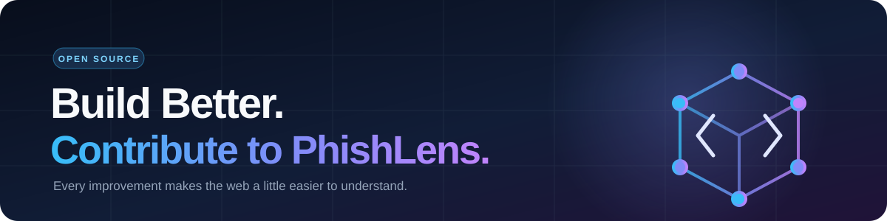

 <div align="center">



</div>

Thank you for helping improve PhishLens! This guide explains how to set up the project, contribute detection rules, and submit quality pull requests.

## 🧭 Ground Rules

1. **Stay local.** Submitted URLs must never be opened, fetched, or transmitted. Do not introduce `fetch`, `XMLHttpRequest`, tracking beacons, or third-party scripts.
2. **Stay honest.** Heuristic analysis is not a malware scan or reputation check. The interface must never imply otherwise.
3. **Stay explainable.** Every detection signal must include a title, weight, and understandable explanation.
4. **Stay lightweight.** Avoid frameworks and build systems. The project must remain runnable through `index.html` or a static server.

## 🛠️ Setup

```bash
git clone https://github.com/rheillunio2-byte/PhishLens.git
cd PhishLens
python -m http.server 8000
```

Alternatively, use the VS Code Live Server extension.

No package installation or build step is required.

## 🌿 Contribution Workflow

1. Fork the repository.
2. Create a dedicated branch:

   ```bash
   git checkout -b feat/short-description
   ```

3. Make focused changes. Keep each pull request centered on one improvement.
4. Test your changes using the checklist below.
5. Commit and push your branch:

   ```bash
   git add .
   git commit -m "feat: describe your improvement"
   git push origin feat/short-description
   ```

6. Open a pull request describing what changed, why it matters, and how it was tested. Include screenshots for visual changes.

### Commit Message Convention

Use these prefixes:

- `feat:` New functionality
- `fix:` Bug fixes
- `docs:` Documentation updates
- `style:` Visual or formatting changes
- `refactor:` Code restructuring without behavior changes

Example: `feat: flag excessive URL path depth`

## 🧩 Adding a Detection Rule

Detection rules are managed in `app.js`. A new rule generally requires three updates:

1. **Weight:** Add a key and numerical weight to the `weights` object.
2. **Logic:** Add a condition inside `analyze()` and call `add(key, title, reason)`.
3. **Label:** Add a readable name to `RULE_LABELS` so the Methodology page can display it.

Example pattern (adapt it to the existing implementation):

```javascript
// 1. Add a weight
const weights = {
  // Existing rules...
  manyParams: 5
};

// 2. Add logic inside analyze()
if ([...url.searchParams].length > 12) {
  add(
    "manyParams",
    "Many query parameters",
    "The URL contains an unusually large number of parameters, which may obscure tracking or redirect information."
  );
}

// 3. Add a label
const RULE_LABELS = {
  // Existing labels...
  manyParams: "Many query parameters"
};
```

**Before submitting a new rule:**

- Explain why the pattern may be suspicious without claiming it proves malicious intent.
- Severity is derived from the rule weight: 18+ is high, 10+ is medium, and lower weights are low.
- Justify changes to existing weights or score classifications in your pull request.
- Update the README if scoring bands or detection behavior change.
- Document possible false positives.

## 🎨 Design Guidelines

- Follow the existing CSS variables in `:root`.
- Maintain the midnight-navy theme with cyan and indigo accents.
- Reserve green, amber, and red primarily for risk indicators.
- Respect `prefers-reduced-motion` for all animations.
- Support responsive layouts down to 360px without horizontal overflow.
- Maintain visible focus states, semantic HTML, and accessible labels.
- New SVGs should use clean vector paths, a valid `viewBox`, an appropriate `<title>`, and no embedded raster images.

## ✅ Pull Request Checklist

- [ ] URL analysis works with sample URLs and invalid input.
- [ ] Scores and signals match their configured weights.
- [ ] Reopening reports does not create duplicate history entries.
- [ ] History can be saved, reopened, and cleared.
- [ ] Text report export works.
- [ ] Navigation works on desktop and mobile.
- [ ] Keyboard-only navigation works.
- [ ] No console errors are introduced.
- [ ] No outbound requests are introduced during URL analysis.
- [ ] Reduced-motion preferences are respected.
- [ ] No horizontal overflow appears on mobile.
- [ ] Documentation is updated when behavior changes.

## 🐞 Reporting Issues

When reporting a bug, include:

- A description of the issue.
- The URL pattern using safe placeholders such as `example.com`, never real victim links.
- The expected and actual results.
- Your browser and operating system.
- A screenshot when the issue involves the interface.

## 🔐 Security

If you discover a security vulnerability, such as a possible XSS issue in report rendering, please contact the repository maintainer privately rather than publishing exploit details in a public issue.

<div align="center">


*Thank you for making links easier to understand.* 🔍

</div>
