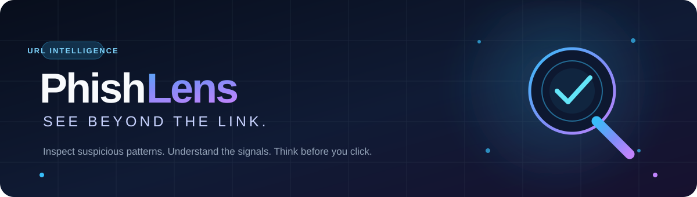
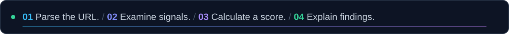
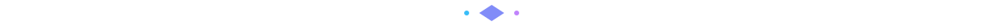
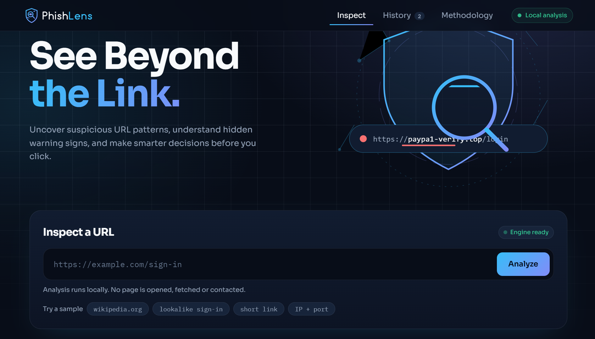
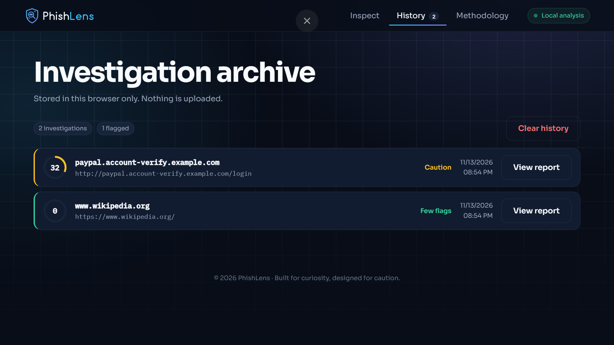
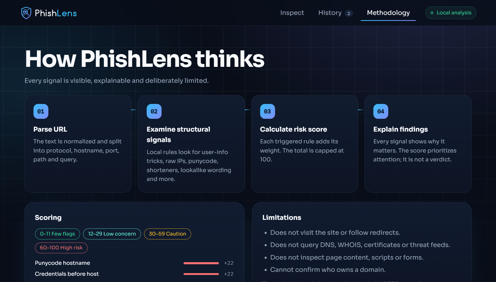

 <div align="center">






**Uncover suspicious URL patterns, understand hidden warning signs, and make smarter decisions before you click.**

[MIT License](https://github.com/rheillunio2-byte/PhishLens?tab=MIT-1-ov-file) · [Report an Issue](https://github.com/rheillunio2-byte/PhishLens/issues) · [Contribute](CONTRIBUTING.md)

</div>



## ✨ What is PhishLens?

PhishLens is an **explainable URL intelligence workbench**. Paste a link and it breaks the address into its components, applies transparent heuristic rules, and explains exactly why each signal matters instead of simply displaying an unexplained "safe" or "unsafe" label.

- 🔒 **Privacy-first:** URLs are analyzed locally in your browser. They are never opened, fetched, or transmitted.
- 🔍 **Explainable:** Every triggered rule displays its weight, severity, and reasoning.
- ⚡ **Zero dependencies:** Built with plain HTML, CSS, and JavaScript. No build process required.

## 🖼️ Screenshots

### Inspect


### History


### Methodology



## 🧭 Features

| Feature | Description |
|---|---|
| 🎯 Risk Gauge | Animated 0–100 risk score with a clear classification |
| 🧩 Signal Breakdown | Severity-coded findings with weights and explanations |
| 🌐 Destination Profile | Hostname, protocol, TLD, subdomain depth, URL length, and HTTPS information |
| 🎞️ Scan Sequence | Visualizes the parsed protocol, hostname, and path |
| 🗂️ Investigation Archive | Saves reports in `localStorage`, with options to reopen and clear them |
| 📄 Report Export | Downloads a plain-text report containing the analysis and triggered signals |
| 📖 Methodology | Displays detection rules and their scoring weights |
| ♿ Accessibility | Keyboard navigation, visible focus indicators, and reduced-motion support |

## 🚀 Quick Start

Clone the repository:

```bash
git clone https://github.com/rheillunio2-byte/PhishLens.git
cd PhishLens
```

**Option A:** Open `index.html` directly in your browser.

**Option B:** Run a local server:

```bash
python -m http.server 8000
```

Visit `http://localhost:8000`, paste a URL, and click **Analyze**. You can also try the sample URLs to explore the detection signals.

## 🧮 How Scoring Works

Each triggered detection rule contributes a predefined weight. The total score is capped at 100.

| Score | Classification |
|---:|---|
| 0–11 | 🟢 Few Flags |
| 12–29 | 🟢 Low Concern |
| 30–59 | 🟡 Caution |
| 60–100 | 🔴 High Risk |

**Important:** These are heuristic scoring bands, not calibrated probabilities. A score of zero does not guarantee that a URL is safe.

## 🛡️ Privacy and Limitations

- Submitted URLs are analyzed entirely in the browser.
- The Content Security Policy uses `connect-src 'none'` to block outbound connections.
- The only third-party request is the Google Fonts stylesheet. Remove its `<link>` from `index.html` to operate without that request.
- PhishLens does not visit websites, follow redirects, query DNS or WHOIS, inspect certificates, or access live threat intelligence feeds.
- Detection rules may produce false positives and false negatives. Never rely on the score as the sole basis for a security decision.

## 📁 Project Structure

```text
PhishLens/
├── index.html
├── styles.css
├── app.js
├── images/
│   ├── Inspect.PNG
│   ├── History.PNG
│   └── Methodology.PNG
├── assets/
│   ├── logo/
│   ├── illustrations/
│   └── readme/
│       ├── banner.svg
│       ├── typing.svg
│       ├── divider.svg
│       └── banner-contributing.svg
├── README.md
├── CONTRIBUTING.md
└── LICENSE
```

## 🤝 Contributing

Contributions are welcome! Whether you're improving detection rules, refining the interface, fixing bugs, or improving documentation, your help is appreciated.

Please read [CONTRIBUTING.md](CONTRIBUTING.md) before submitting a pull request.

## 📄 License

PhishLens is distributed under the **MIT License**. See the [LICENSE file](https://github.com/rheillunio2-byte/PhishLens?tab=MIT-1-ov-file) for details.

<div align="center">


*Built for curiosity. Designed for caution.* 🔍

</div>
